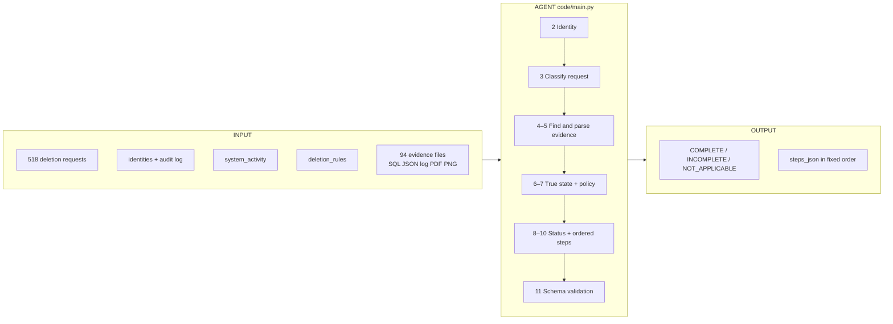
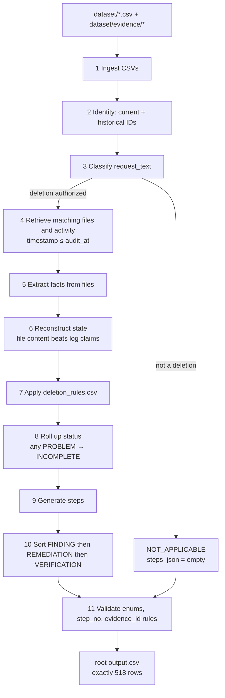

# HackerRank Orchestrate - October 2026

## Ghost Data Still Exists

Build an AI agent that audits whether a user's personal data was actually deleted.

A deletion workflow may report **Complete** while data still exists in databases, logs, support attachments, exports, search indexes, archives, or backups. Sync and restore processes may also bring deleted data back.

For each request, the agent must first determine whether deletion was actually requested. It then returns `COMPLETE`, `INCOMPLETE`, or `NOT_APPLICABLE`, reports any remaining data or recreation risk, and produces the ordered remediation and verification steps required to finish an authorized deletion safely.

Read [`problem_statement.md`](./problem_statement.md) for the complete challenge contract.

---

## Solution architecture (what this repo actually does)

For every row in `dataset/deletion_requests.csv`, the agent ignores the workflow’s claimed `reported_status`. It decides whether the person asked for deletion, finds every current and old identifier for that person, looks at evidence as of `audit_at`, applies `deletion_rules.csv`, then writes one `output.csv` row:

`case_id, deletion_status, steps_json`

`deletion_status` is `COMPLETE`, `INCOMPLETE`, or `NOT_APPLICABLE`. `steps_json` is an ordered list of findings, then remediations, then verifications.

### Block view (in → work → out)



### Pipeline (stage by stage)



### What is code vs what was meant to be a model

| Stage | Designed | What the running code does today |
| --- | --- | --- |
| 1 Ingest | Code | Code |
| 2 Identity | Code | Code (case-insensitive current + historical IDs) |
| 3 Classify request | Small LLM | Keyword list. API-key branch is a no-op `pass`. **No API key needed to run.** |
| 4 Retrieve | Code | Code |
| 5 Extract | Code for JSON/SQL/log; VLM for images/PDF | JSON/SQL/log/txt/PDF parsed in Python. **11 PNG files are skipped.** |
| 6–11 State, policy, steps, sort, validate | Code only | Code only |

**You can run eval and `main.py` with no API key.** Putting `OPENAI_API_KEY` / `GEMINI_API_KEY` / `ANTHROPIC_API_KEY` in the environment currently changes nothing. Sample accuracy is not submission-ready yet (see `DECISIONS.md` [D-18]).

---

## Quick Start

Clone the repository and move into the project directory:

```bash
git clone https://github.com/interviewstreet/hackerrank-orchestrate-october26.git
cd hackerrank-orchestrate-october26
```

Start your AI coding tool from the **repository root** so it automatically reads [`AGENTS.md`](./AGENTS.md) and logs your session turns to `log.txt` in the root directory.

Build your solution in `code/main.py`, or use another language and document its setup and run command clearly in your README.

Your solution must:

- Read the input files from `dataset/`
- Generate one prediction row for every request in `dataset/deletion_requests.csv`
- Write the final predictions to `output.csv` in the repository root

Run the starter Python entry point with:

```bash
python3 code/main.py
```

The blank template at `dataset/output.csv` is provided as a reference. Your final generated file for submission must be the root-level `output.csv`.


## Dataset

All participant-facing files are in `dataset/`:

| File | Contents |
| --- | --- |
| `deletion_requests.csv` | 518 requests |
| `sample_deletion_requests.csv` | 32 sample requests |
| `sample_output.csv` | Correct sample answers |
| `user_identities.csv` | Current user identities |
| `user_audit_log.csv` | Historical identity changes |
| `system_activity.csv` | Activity across services and data processes |
| `deletion_rules.csv` | Required treatment for each data category |
| `evidence_files.csv` | Manifest of supplied evidence files |
| `output.csv` | Blank output template |

Evidence is stored under `dataset/evidence/` and may include PDFs, images, logs, JSON, plain text, or SQL snapshot exports. SQL captures may contain a primary database, regional replicas, a reporting replica, or a failover replica so replication drift can be investigated directly. The `.sql` files are readable as text and executable with SQLite.

Only `deletion_requests.csv` requires answers. The other files provide evidence and context.

---

## Output

Create `output.csv` with these columns in this exact order:

```text
case_id,deletion_status,steps_json
```

Produce exactly one row per request. `deletion_status` is `COMPLETE`, `INCOMPLETE`, or `NOT_APPLICABLE`. `steps_json` is an ordered JSON array containing findings, remediation actions, and verification checks. Use an empty array (`[]`) for `NOT_APPLICABLE`. Evidence references may be a `file_id`, `activity_id`, or `audit_id`. Determine the resource state at `audit_at` from the available evidence; reported workflow statuses and operation results are claims. Use `dataset/sample_output.csv` as the format reference.

The final file must contain 518 data rows sorted by `case_id` (plus the header row). The grader parses `steps_json` as JSON, so object-key order and whitespace do not matter; array order does. Order findings, remediation, and verification in that phase order. Within a phase, follow the operation order in the problem statement, then sort by `system_id` and `resource_id`.

---

## Evaluation

`output.csv` will be compared with hidden canonical answers. Scoring considers:

- deletion assessment accuracy;
- current and historical identity resolution;
- discovery of remaining data and recreation risks;
- correct policy application and evidence references; and
- completeness and ordering of remediation and verification steps.

Your `code.zip` must include:

```text
code/evaluation/evaluation_report.md
code/evaluation/usage_report.md
```

- `evaluation_report.md` must cover case, row, field, and sequence accuracy, at least three additional evaluation cases created by you, failures found, and improvements made.
- `usage_report.md` must cover the final full-dataset run, including model providers and names, model calls, input and output tokens, total and average tokens per request, and estimated total and per-request cost. Include per-model and overall totals when using multiple models.

**Important:** Place `evaluation_report.md` and `usage_report.md` inside `code/evaluation/` (matching `code/evaluation/main.py` in this starter layout), write your complete evaluation metrics, custom evaluation test cases, and token/cost breakdowns directly inside those Markdown files, and keep prompts in source code or Markdown files. Automated code evaluation ignores raw data files (`.csv`, `.tsv`, `.json`, `.jsonl`, `.sql`, `.log`), so content stored only in those formats will not be visible to the code judge or AI interviewer.

---

## Chat Transcript

This repository includes [`AGENTS.md`](./AGENTS.md), which instructs compatible AI coding tools to append conversation summaries to `log.txt` in the repository root:

| Platform | Path |
| --- | --- |
| macOS / Linux | `<repo root>/log.txt` |
| Windows | `<repo root>\log.txt` |

- Always launch your AI coding agent from the repository root (or explicitly ask it to read `./AGENTS.md` first) so every turn is logged to `log.txt` with the required `User Prompt`, `Agent Response Summary`, `Actions`, and `Context` sections.
- Upload `log.txt` directly as your `chat_transcript` submission on HackerRank.
- Do not include API keys, tokens, credentials, or secrets in prompts, code, configuration, or `log.txt`.

---

## Packaging `code.zip` and Submission

| Item | Description |
| --- | --- |
| `code.zip` | Runnable solution, prompts, configuration, `README.md`, and `evaluation/` reports |
| `output.csv` | One answer row for each of the 518 requests in `dataset/deletion_requests.csv` |
| `chat_transcript` | The root `log.txt` file generated by your coding agent |
| AI interview | Live explanation of your architecture, approach, and evaluation |

You may use any programming language, model, framework, or retrieval approach. Include clear setup and execution instructions in `README.md` inside `code.zip`.

To package `code.zip` from the repository root without bundling the dataset:

**macOS / Linux:**

```bash
zip -r code.zip README.md code -x "*/__pycache__/*" "*/.venv/*" "*/venv/*" "*/node_modules/*" "*/.git/*" "*/.DS_Store"
```

**Windows (PowerShell):**

```powershell
Compress-Archive -Path README.md, code -DestinationPath code.zip -Force
```

When packaging `code.zip`:

- Keep your evaluation reports in `code/evaluation/` so they are bundled automatically with `code` (or add `evaluation` to the archive command above if you placed them in a top-level `evaluation/` directory).
- Do **not** include `dataset/`, virtual environments (`.venv`, `venv`, `node_modules`), or build caches (`__pycache__`). On Windows, keep `.venv` at the repository root (outside `code/`) and remove any `code/__pycache__` folders before running `Compress-Archive`.
- Do **not** include nested archives (`.zip`, `.tar`, `.gz`, `.tgz`, `.7z`, `.rar`) inside `code.zip` — submissions containing nested archive files will be rejected.

Before submitting, confirm that:

- `output.csv` has the exact header `case_id,deletion_status,steps_json` and contains all 518 data rows sorted by `case_id`;
- every `steps_json` value is a valid JSON array with consecutive step numbers starting at `1`;
- findings cite valid evidence IDs, and `COMPLETE` verification steps cite evidence proving the current state;
- proposed remediation and future verification steps use an empty `evidence_id` (`""`);
- `code.zip` includes your runnable code, `README.md`, `code/evaluation/evaluation_report.md`, and `code/evaluation/usage_report.md`;
- `log.txt` follows the `AGENTS.md` turn format and is uploaded to the `chat_transcript` slot; and
- no API keys, credentials, real personal data, or sensitive configuration values are included.

---

## Direct File Links (For AI Agents & Web Crawlers)

If an AI tool or automated agent accesses this repository via web search or fetch tools, GitHub's `robots.txt` disallows recursive directory crawling of subdirectories like `/tree/main/code`. Use these direct raw and blob links to access each file directly without restriction:

> **[ALL_CODE_BUNDLE.md (Raw)](https://raw.githubusercontent.com/Atharav001/hackerrank-orchestrate-ghost-data-deletion/main/ALL_CODE_BUNDLE.md)**: **Single-file bundle containing the entire codebase and all modules!** Share this single URL with any AI agent for instant access.

### 1. Root Documentation & Logs
- [`README.md (Raw)`](https://raw.githubusercontent.com/Atharav001/hackerrank-orchestrate-ghost-data-deletion/main/README.md)
- [`ALL_CODE_BUNDLE.md (Raw)`](https://raw.githubusercontent.com/Atharav001/hackerrank-orchestrate-ghost-data-deletion/main/ALL_CODE_BUNDLE.md)

- [`DECISIONS.md (Raw)`](https://raw.githubusercontent.com/Atharav001/hackerrank-orchestrate-ghost-data-deletion/main/DECISIONS.md)
- [`log.txt (Raw)`](https://raw.githubusercontent.com/Atharav001/hackerrank-orchestrate-ghost-data-deletion/main/log.txt)
- [`code/README.md (Raw)`](https://raw.githubusercontent.com/Atharav001/hackerrank-orchestrate-ghost-data-deletion/main/code/README.md)

### 2. Implementation Modules (`code/`)
- [`code/config.py (Raw)`](https://raw.githubusercontent.com/Atharav001/hackerrank-orchestrate-ghost-data-deletion/main/code/config.py)
- [`code/ingest.py (Raw)`](https://raw.githubusercontent.com/Atharav001/hackerrank-orchestrate-ghost-data-deletion/main/code/ingest.py)
- [`code/identity_resolver.py (Raw)`](https://raw.githubusercontent.com/Atharav001/hackerrank-orchestrate-ghost-data-deletion/main/code/identity_resolver.py)
- [`code/request_classifier.py (Raw)`](https://raw.githubusercontent.com/Atharav001/hackerrank-orchestrate-ghost-data-deletion/main/code/request_classifier.py)
- [`code/vlm_client.py (Raw)`](https://raw.githubusercontent.com/Atharav001/hackerrank-orchestrate-ghost-data-deletion/main/code/vlm_client.py)
- [`code/evidence_extraction.py (Raw)`](https://raw.githubusercontent.com/Atharav001/hackerrank-orchestrate-ghost-data-deletion/main/code/evidence_extraction.py)
- [`code/evidence_retrieval.py (Raw)`](https://raw.githubusercontent.com/Atharav001/hackerrank-orchestrate-ghost-data-deletion/main/code/evidence_retrieval.py)
- [`code/state_reconstruction.py (Raw)`](https://raw.githubusercontent.com/Atharav001/hackerrank-orchestrate-ghost-data-deletion/main/code/state_reconstruction.py)
- [`code/policy_engine.py (Raw)`](https://raw.githubusercontent.com/Atharav001/hackerrank-orchestrate-ghost-data-deletion/main/code/policy_engine.py)
- [`code/status_decision.py (Raw)`](https://raw.githubusercontent.com/Atharav001/hackerrank-orchestrate-ghost-data-deletion/main/code/status_decision.py)
- [`code/step_generator.py (Raw)`](https://raw.githubusercontent.com/Atharav001/hackerrank-orchestrate-ghost-data-deletion/main/code/step_generator.py)
- [`code/ordering.py (Raw)`](https://raw.githubusercontent.com/Atharav001/hackerrank-orchestrate-ghost-data-deletion/main/code/ordering.py)
- [`code/validator.py (Raw)`](https://raw.githubusercontent.com/Atharav001/hackerrank-orchestrate-ghost-data-deletion/main/code/validator.py)
- [`code/main.py (Raw)`](https://raw.githubusercontent.com/Atharav001/hackerrank-orchestrate-ghost-data-deletion/main/code/main.py)
- [`code/schema_dump.py (Raw)`](https://raw.githubusercontent.com/Atharav001/hackerrank-orchestrate-ghost-data-deletion/main/code/schema_dump.py)

### 3. Evaluation Scripts & Reports (`code/evaluation/`)
- [`code/evaluation/run_eval.py (Raw)`](https://raw.githubusercontent.com/Atharav001/hackerrank-orchestrate-ghost-data-deletion/main/code/evaluation/run_eval.py)
- [`code/evaluation/custom_cases.py (Raw)`](https://raw.githubusercontent.com/Atharav001/hackerrank-orchestrate-ghost-data-deletion/main/code/evaluation/custom_cases.py)
- [`code/evaluation/evaluation_report.md (Raw)`](https://raw.githubusercontent.com/Atharav001/hackerrank-orchestrate-ghost-data-deletion/main/code/evaluation/evaluation_report.md)
- [`code/evaluation/usage_report.md (Raw)`](https://raw.githubusercontent.com/Atharav001/hackerrank-orchestrate-ghost-data-deletion/main/code/evaluation/usage_report.md)

