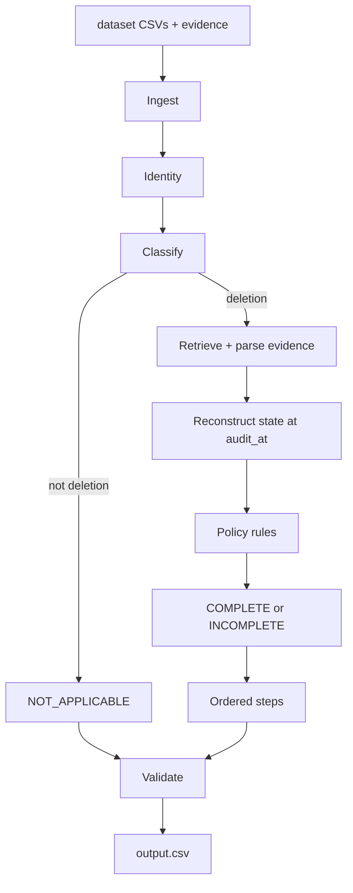

# Ghost Data Deletion Audit Agent — HackerRank Orchestrate (October 2026)

## Overview
This solution implements an AI-powered data deletion audit agent for Northstar Shop. For every deletion request, the agent resolves current and historical identity identifiers, searches global operational activity and evidence files, applies retention policies, reconstructs the true deletion state at `audit_at`, and generates strictly ordered findings, remediation steps, and verification checks.

## Architecture
- **Stage 1 (Ingestion):** Loads participant CSVs (`deletion_requests.csv`, `user_identities.csv`, `user_audit_log.csv`, `system_activity.csv`, `deletion_rules.csv`, `evidence_files.csv`).
- **Stage 2 (Identity Resolution):** Reconstructs complete identifier sets (current + historical emails, phones, hashes, names) with case-insensitive normalization.
- **Stage 3 (Request Classification):** Distinguishes deletion authorizations from non-deletion inquiries (`NOT_APPLICABLE`).
- **Stage 4 & 5 (Evidence Retrieval & Extraction):** Indexes and extracts facts across 94 evidence files (JSON, SQL replicas, logs, text handovers, PDFs).
- **Stage 6 (State Reconstruction):** Fuses evidence proof over activity claims at cutoff time `audit_at`.
- **Stage 7 (Policy Engine):** Applies `deletion_rules.csv` mapping categories to required treatments (`DELETE`, `REDACT`, `ANONYMIZE`, `RETAIN`).
- **Stage 8 & 9 (Status & Step Generation):** Derives `COMPLETE`, `INCOMPLETE`, or `NOT_APPLICABLE` and generates phase-grouped steps.
- **Stage 10 (Deterministic Ordering):** Enforces strict phase ordering (`FINDING` -> `REMEDIATION` -> `VERIFICATION`) and operation-priority sorting.
- **Stage 11 (Validation):** Verifies all schema, enum, array consecutive numbering, and evidence rules.



**API keys:** not required for the current run. Env vars `OPENAI_API_KEY`, `GEMINI_API_KEY`, and `ANTHROPIC_API_KEY` are checked in `request_classifier.py` and `vlm_client.py`, but those branches do not call a model yet.

## Installation & Requirements
- Python 3.10+
- Dependencies: `pandas`, `pypdf`, `pillow`

Install required packages:
```bash
pip install pandas pypdf pillow
```

## How to Run

### Run the full pipeline
From the repository root:
```bash
python3 code/main.py
```
This generates `output.csv` with exactly 518 data rows at the repository root.

### Run evaluation
```bash
python3 code/evaluation/run_eval.py
```

### Run schema validation standalone
```bash
python3 code/validator.py
```
